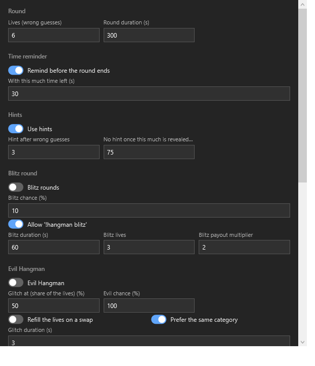
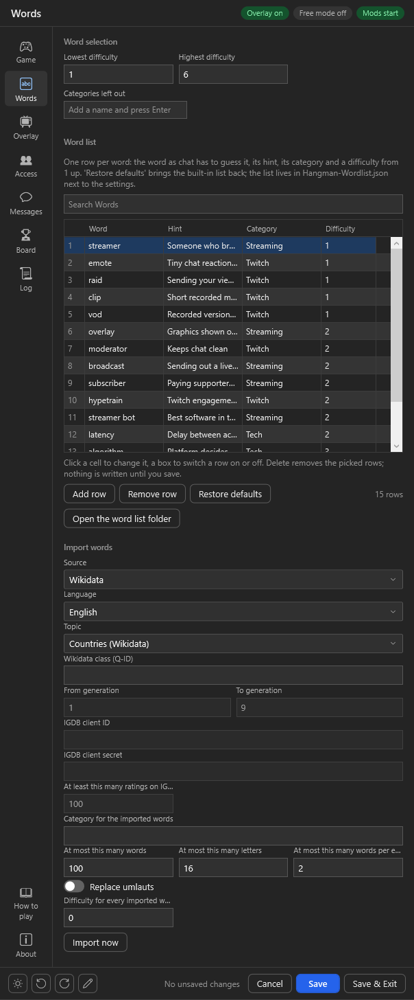
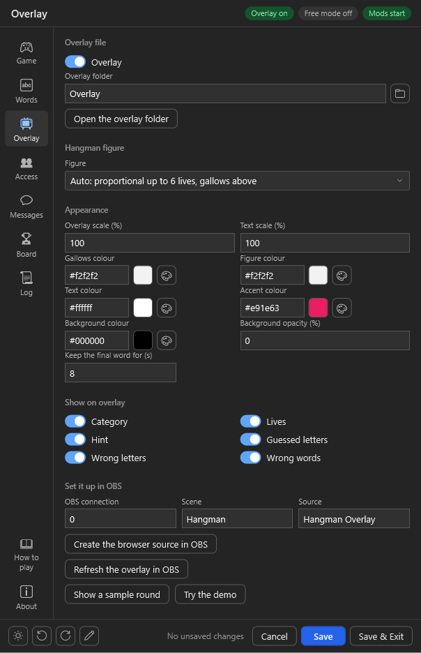
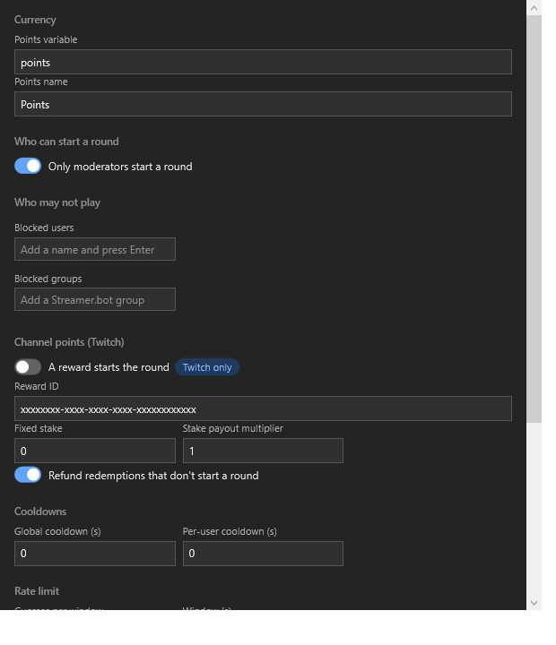
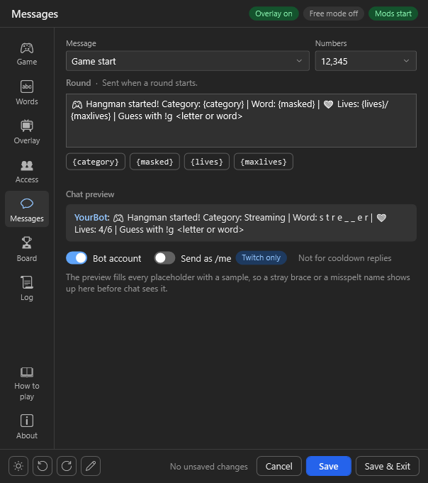
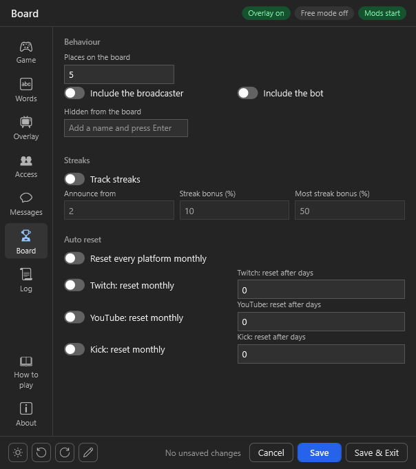
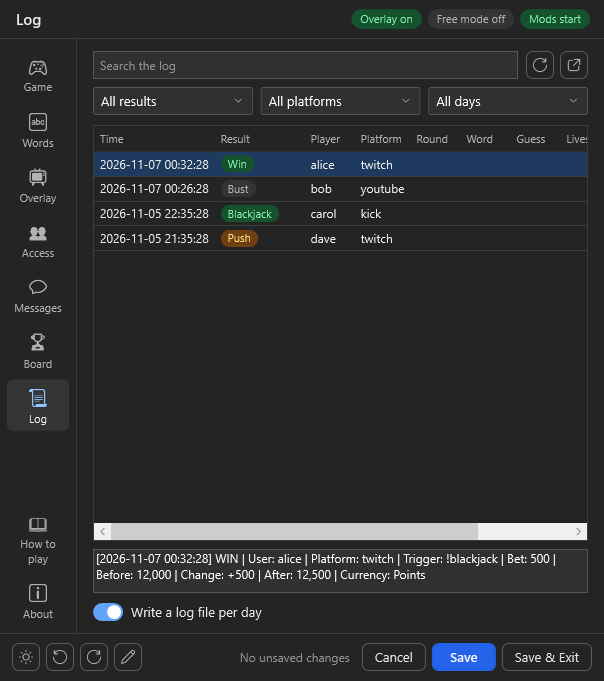

# Import

 
 

Click on `Import` in [streamer.bot](https://streamer.bot/) and drag the [HangmanGame.sb](https://github.com/aaskjer/Hangman-Game/releases) file into the window or copy paste the [import string](https://github.com/aaskjer/Hangman-Game/blob/main/Import-String.md).

 

Click on `Import` and `Yes` on both following popup messages.

## Enable Commands

 

Enable all commands in the `Commands` tab of streamer.bot.

# Setup

 
 
Right-Click on `Test` and click `Test Trigger` in the trigger section of `[HM] - Settings` to open the GUI of the game.

The first time, a small dialog asks whether to download `UIFramework.dll` - the settings window itself, shared by all of these chat games and kept at [aaskjer/UIFramework-Streamer.bot](https://github.com/aaskjer/UIFramework-Streamer.bot). `Yes` fetches it (checked against its published hash) into `UIFramework\lib\<version>\` next to Streamer.bot; `No` opens that folder so you can place the file from the [releases](https://github.com/aaskjer/UIFramework-Streamer.bot/releases) yourself. When a newer window is released, the next open offers it the same way.

The window has one page per subject, picked from the rail on the left. Every field carries a tooltip, so hovering usually answers the question faster than this page does. The pencil at the bottom left opens the customise mode: rename, reorder, hide or move pages and fields, pick an accent colour and the language (English or German); the window keeps that layout in `uiframework.layout.json` next to `configs.json`, through every update of the game.

## Game

Lives, round duration and the time reminder, then when hints appear and what a win pays. Word scaling sits here too: harder and longer words earn a percentage on top, capped so a very long word cannot run away with your currency.

Between the hints and the payout sit the two optional twists. [Blitz](https://github.com/aaskjer/Hangman-Game/blob/main/FAQ.md#-blitz-rounds) sets how often a round turns into a short, multiplied one and whether mods may call one with `!hm blitz`. [Evil Hangman](https://github.com/aaskjer/Hangman-Game/blob/main/FAQ.md#-evil-hangman) sets when the word is swapped, whether lives refill, and how long the overlay glitches.

## Words

Add, edit and delete [words](https://github.com/aaskjer/Hangman-Game/blob/main/FAQ.md#-wordlist), one row each with a [hint](https://github.com/aaskjer/Hangman-Game/blob/main/FAQ.md#-hints), a category and a difficulty; `Add row` adds one, `×` takes one out, `Restore defaults` brings the built-in list back. The difficulty range and the categories left out sit above the list.

*Import words* [fetches words](https://github.com/aaskjer/Hangman-Game/blob/main/FAQ.md#-importing-words) with hints from Wikidata, OdeNet, PokéAPI or IGDB: pick a source, a topic and the limits, then *Import now*. Words the list already holds are skipped, the rest lands in `Hangman-Wordlist.json` in the category you named - reopen the window to see them in the list.

## Overlay

A local HTML file that OBS loads as a browser source and that repaints itself as the round runs. *Create the browser source in OBS* creates the scene and the source over your existing Streamer.bot OBS connection. The gallows, the colours, the scale and what is shown next to the word are all set here.

OBS keeps showing the overlay it loaded until the browser source is refreshed. The game does that by itself after an update; *Refresh the overlay in OBS* does it on demand.

*Try the demo* opens the overlay in your browser and plays made-up rounds with your saved look, no Streamer.bot needed; `&demo=1` at the end of the browser source's address in OBS does the same, so you can place and size the source. *Show a sample round* plays one made-up round on the overlay that is open, the one in OBS included, then puts it back; it waits for no one, so if you are live your viewers see it too, and it refuses while a real round runs.

## Access

Who may start a round and who may not play at all, the start cooldowns, the guess rate limit, and the addicted list for regulars who should earn less and pace themselves. Channel Points live here as well.

Channel Points are a work in progress. The code came from another game and the author is not an affiliate, so it is not properly tested — if something misbehaves, please report it [here](https://github.com/aaskjer/Hangman-Game/issues).

## Messages

Every line the game posts, in one place. Pick a message, edit it, and the preview shows how it will read in chat; the chips under the box insert the placeholders that message accepts. The bot account and `/me` switches apply to the game's messages and to the cooldown replies separately. The Free mode messages are here too.

## Board

How many players the scoreboard shows, who is left off it, and when it resets. Reset runs per platform or for all of them at once.

[Streaks](https://github.com/aaskjer/Hangman-Game/blob/main/FAQ.md#-streaks) are switched on here: from which length they are announced, and the bonus a streak adds to a win.

## Log

Every round, guess and payout, one file per day in the `Logs` folder. Filter by result, platform or day, or search the text; *Write a log file per day* switches the file off.

## How to play, About

What a round is, every command, what a win pays, the custom triggers and where the files live, in the window itself; About names the version, the points systems the game picks up and the links.

---

[Frequently Asked Questions](https://github.com/aaskjer/Hangman-Game/blob/main/FAQ.md)
